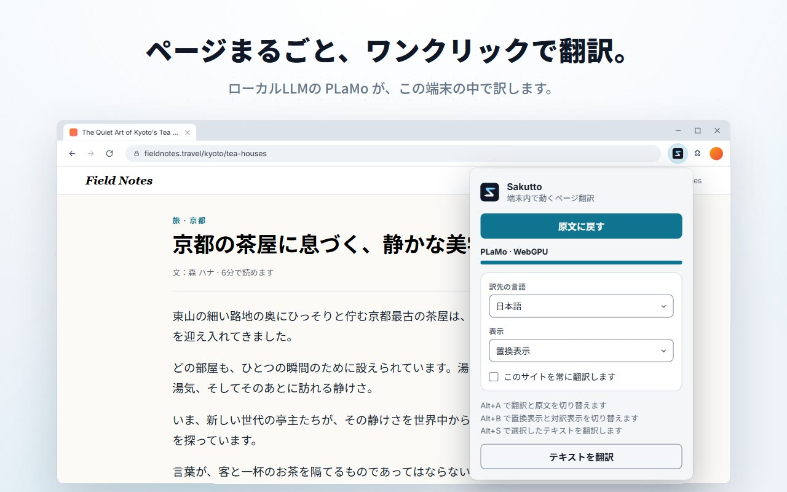
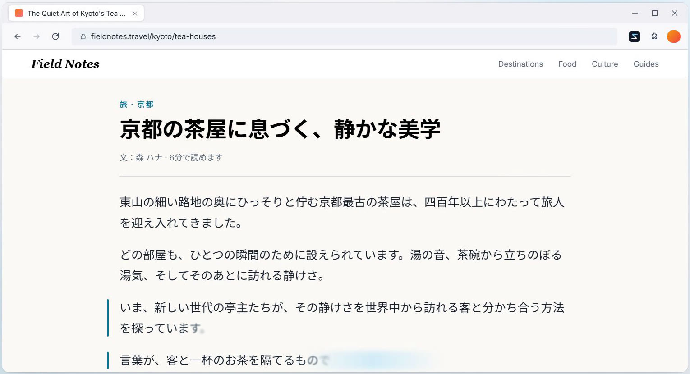
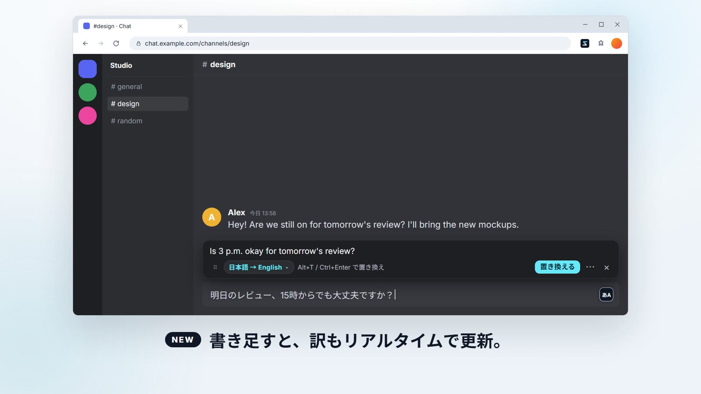
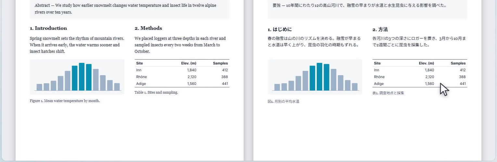
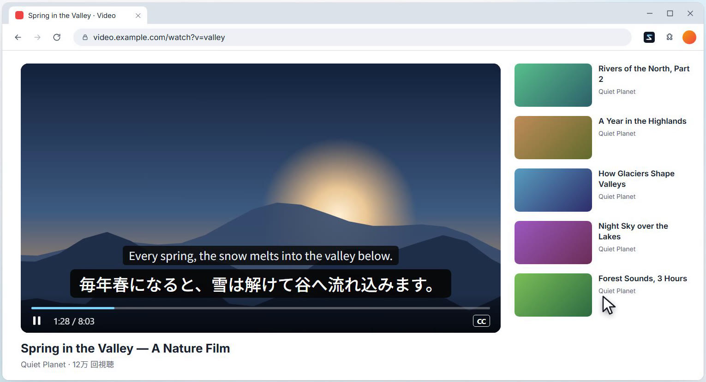
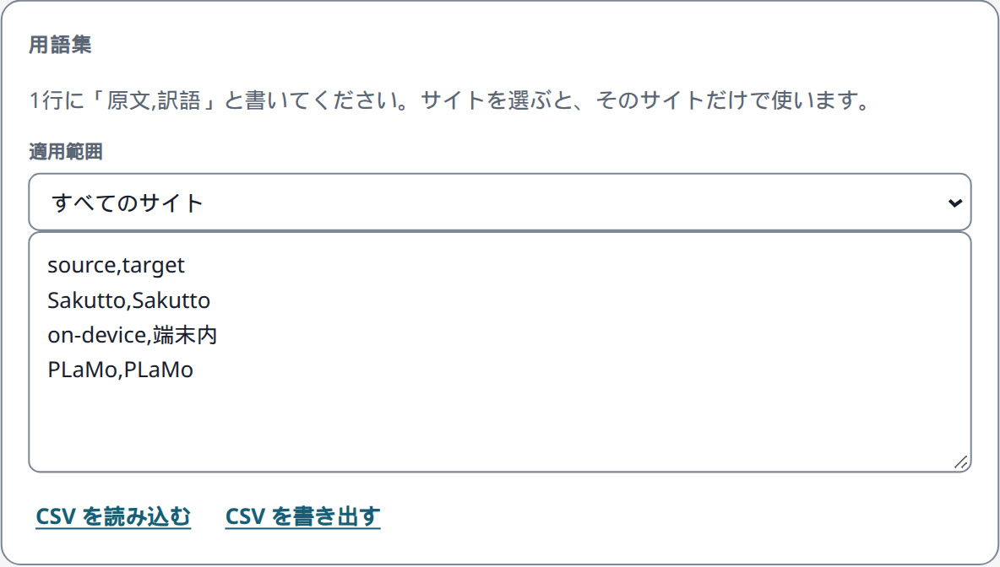
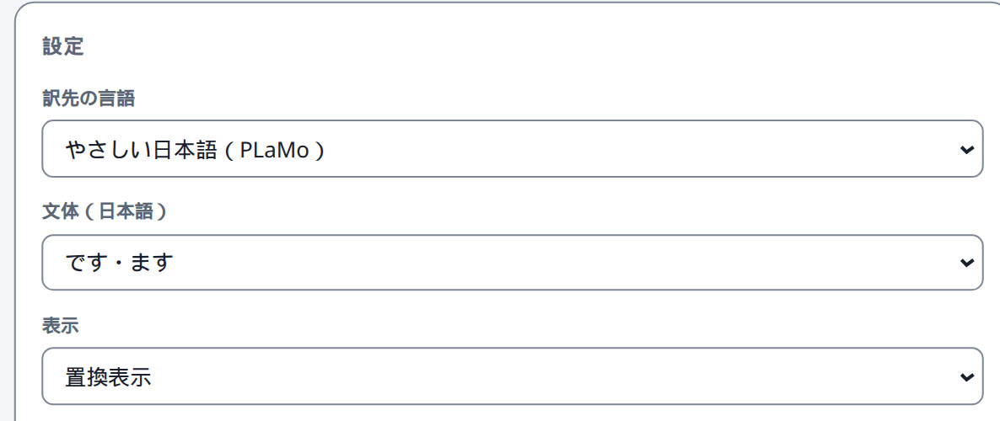
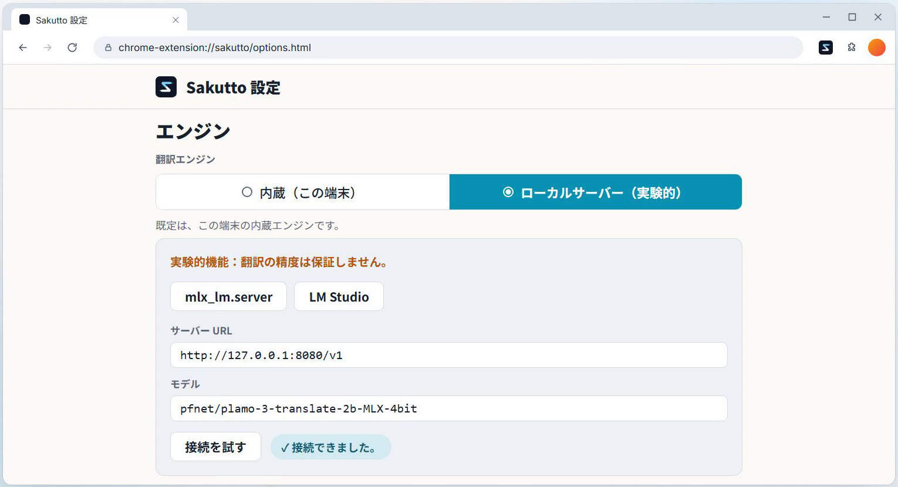

<div align="center">
  
  <h1>Sakutto</h1>
  <p><strong>ページも、PDF も、動画も、入力中の文も。端末の中で、PLaMo で翻訳。</strong></p>
  <p>
    <a href="https://chrome.google.com/webstore/detail/mhlbjjijfkoghmcjndgdimhdlfkhadfl"></a>
    <a href="https://chrome.google.com/webstore/detail/mhlbjjijfkoghmcjndgdimhdlfkhadfl"></a>
    <a href="https://chrome.google.com/webstore/detail/mhlbjjijfkoghmcjndgdimhdlfkhadfl"></a>
    <a href="https://addons.mozilla.org/ja/firefox/addon/sakutto-local-ai-translation/"></a>
    <a href="LICENSE"></a>
    <a href="CHANGELOG.md"></a>
    <a href="https://discord.gg/pdSRBaSr38"></a>
    <a href="https://github.com/jammaru/sakutto/stargazers"></a>
  </p>
  
</div>

Sakutto は、ウェブページ、PDF、動画の字幕、選択範囲、入力中のテキストを端末内で翻訳する、Chrome と Firefox 向けの非公式拡張機能です。既定のエンジンは [PLaMo 3 Translate](https://huggingface.co/pfnet/plamo-3-translate-0.8b-GGUF) で、ピン留めした [wllama](https://github.com/ngxson/wllama) のビルドを WebGPU または CPU で動かします。

PLaMo が対応する 53 言語では、訳文はすべて PLaMo が生成します。Chrome で Chrome 内蔵翻訳を使うのは、PLaMo が生成できない 11 言語の訳先だけです。Firefox は PLaMo のみを使います。アカウント、広告、テレメトリはありません。Built with PLaMo. Preferred Networks, Inc. とは関係ありません。

## 目次

- [Sakutto を選ぶ理由](#sakutto-を選ぶ理由)
- [機能](#機能)
- [インストール](#インストール)
- [ショートカット](#ショートカット)
- [よくある質問](#よくある質問)
- [プライバシー](#プライバシー)
- [権限](#権限)
- [開発](#開発)
- [貢献](#貢献)
- [支援](#支援)
- [コントリビューター](#コントリビューター)
- [スポンサー](#スポンサー)
- [ライセンス](#ライセンス)

## Sakutto を選ぶ理由

- **既定で端末内。** ページの本文、選択範囲、用語集、訳文は端末の外へ出ません。分析もクラッシュ報告もありません。
- **読むものも、書くものも。** ページ全体、選択範囲、PDF、動画の字幕、メッセージ欄、専用のテキストページを、別の道具に切り替えずに翻訳できます。
- **PDF の組版を保つ。** 段組、表、キャプション、回転したページの構造をそのまま残し、訳文を元の文字が占めていた空間に収めます。
- **無料でオープンソース。** MIT ライセンスのコードで、広告も有料機能もありません。Chrome 版と Firefox 版があります。

## 機能

<table>
  <tr>
    <td width="54%" valign="top">
      <h3>ページ全体と選択範囲の翻訳</h3>
      <p>ページを置換表示で翻訳するか、対訳表示に切り替えます。文字を選ぶと端末内で翻訳したポップアップが出て、文字サイズとパネルの幅を調整できます。</p>
      <p>サイトごとに訳先言語を設定でき、必要なサイトでは自動翻訳をオンにできます。PLaMo の準備ができるまでページは原文のままです。別のエンジンの下書きは挟みません。</p>
    </td>
    <td width="46%" valign="top">
      
    </td>
  </tr>
  <tr>
    <td width="54%" valign="top">
      <h3>入力中でも、専用ページでも</h3>
      <p>メッセージ欄やテキストエリアなどの入力欄にフォーカスして Alt+T（Mac では Option+T）を押すと、欄の上に訳のプレビューが出ます。もう一度押すか Ctrl+Enter（⌘+Enter）で下書きを置き換え、「元に戻す」で元の文に戻せます。</p>
      <p>欄の近くの「あA」ボタンでも同じ操作ができます。専用のテキスト入力ページは最大 100,000 文字に対応し、訳文をコピーできます。パスワード欄と、翻訳しない設定のサイトは対象外です。</p>
    </td>
    <td width="46%" valign="top">
      
    </td>
  </tr>
  <tr>
    <td colspan="2" valign="top">
      <h3>Gmail と Outlook のメールバナー</h3>
      <p><code>mail.google.com</code> と Outlook on the web（<code>outlook.live.com</code>、<code>outlook.office.com</code>、<code>outlook.office365.com</code>、<code>outlook.cloud.microsoft</code>）で、展開したメール本文の言語が訳先と異なるときだけ、本文の上にバナーが出て、そのメールだけを翻訳できます。クリックするまで処理は始まらず、翻訳後に × を押すと原文に戻してそのメールではバナーを隠します。サイトへのアクセスは既存の任意ホスト権限の範囲です。</p>
    </td>
  </tr>
  <tr>
    <td width="54%" valign="top">
      <h3>PDF リーダーの翻訳</h3>
      <p>ブラウザは PDF を専用のビューアで描くため、拡張機能から本文を読めません。Sakutto はファイルを自分で読み、専用のリーダーで開いてページごとに翻訳します。英語の論文を日本語へ、日本語の文書を英語へ、その他の対応言語へも翻訳できます。</p>
      <p>組版はそのままです。2 段組は 2 段組のまま、表の数字は見出しの下のまま、図のキャプションは図のそばに残ります。訳先と同じ言語のブロックは描いたままにし、画像だけのページは推測せず、翻訳できる文字がないことを伝えます。</p>
    </td>
    <td width="46%" valign="top">
      
    </td>
  </tr>
  <tr>
    <td width="54%" valign="top">
      <h3>動画の字幕翻訳</h3>
      <p>YouTube（ライブを含む）と X の字幕を、動画の再生中に端末内で翻訳し、プレーヤーの上に重ねて表示します。HTML5 の字幕トラックと、自分で追加した字幕サイトにも対応します。</p>
      <p>字幕翻訳はオンにするまで動きません。文字サイズのスライダー、YouTube と X それぞれの位置のドラッグ、位置のリセット、原文を隠す操作があります。</p>
    </td>
    <td width="46%" valign="top">
      
    </td>
  </tr>
  <tr>
    <td width="54%" valign="top">
      <h3>用語集</h3>
      <p>全体用とサイト別の用語集を用意し、人名、製品名、技術用語を自分の表記で返せます。1 つのリストには最大 5,000 語、1 回の翻訳では最大 10,000 語までまとめて使えます。</p>
      <p>そのときの文章に出てくる語だけがプロンプトに入ります。設定画面から CSV を読み込み・書き出しできます。</p>
    </td>
    <td width="46%" valign="top">
      
    </td>
  </tr>
  <tr>
    <td width="54%" valign="top">
      <h3>やさしい日本語（ja-easy）</h3>
      <p>訳先に「やさしい日本語」を選ぶと、ふだんの日本語を、よりやさしい日本語にできます。公共情報やアクセシビリティ、日本語を学ぶ人への案内に向いています。日本語のページを、日本語のまま言い換えられます。</p>
      <p>この訳先を生成できるのは PLaMo だけです。Chrome の内蔵翻訳では作れないため、Chrome に渡すことはありません。</p>
    </td>
    <td width="46%" valign="top">
      
    </td>
  </tr>
  <tr>
    <td width="54%" valign="top">
      <h3>ローカル OpenAI 互換サーバー（実験的）</h3>
      <p>設定から、PLaMo のリクエストをこの端末上の OpenAI 互換サーバーへ向けられます。<code>mlx_lm.server</code>、LM Studio、<code>llama-server</code> 系のツールなどが使えます。対応するのは PLaMo のモデルだけです。</p>
      <p>Sakutto の PFML3 プロンプトを raw の <code>/v1/completions</code> に送ります。chat completions は使いません。精度は保証されず、内蔵エンジンと訳が異なることや、誤訳が出ることがあります。既定は組み込みエンジンのままです。</p>
    </td>
    <td width="46%" valign="top">
      
    </td>
  </tr>
</table>

## インストール

Sakutto は両方のストアで公開しています。

- **Chrome ウェブストア** — [Sakutto - ローカルAI翻訳](https://chrome.google.com/webstore/detail/mhlbjjijfkoghmcjndgdimhdlfkhadfl)（Chrome 116 以降）。
- **Firefox Add-ons** — [Sakutto - ローカルAI翻訳](https://addons.mozilla.org/ja/firefox/addon/sakutto-local-ai-translation/)（Firefox 153 以降）。

**3 ステップで使い始められます。**

1. お使いのブラウザのストアからインストールし、Sakutto をツールバーにピン留めします。
2. ポップアップで **このページを翻訳** を選ぶか、Alt+A（Mac では Option+A）を押します。
3. PLaMo のライセンスに同意し、初回だけのモデルのダウンロードが終わるまで待ちます。そのあとは端末内で翻訳され、オフラインでも使えます。

アカウントは不要です。モデルの重みは、このリポジトリにもストアのパッケージにも含まれません。

## ショートカット

| 操作                                     | Windows / Linux                 | Mac                                    |
| ---------------------------------------- | ------------------------------- | -------------------------------------- |
| ページを翻訳する、または原文に戻す       | Alt+A（Firefox は Alt+Shift+A） | Option (⌥)+A（Firefox は Alt+Shift+A） |
| 置換表示と対訳表示を切り替える           | Alt+B（Firefox は Alt+Shift+B） | Option (⌥)+B（Firefox は Alt+Shift+B） |
| 選択範囲を翻訳する                       | Alt+S（Firefox は Alt+Shift+S） | Option (⌥)+S（Firefox は Alt+Shift+S） |
| 入力中のテキストを翻訳する               | Alt+T（Firefox は Alt+Shift+T） | Option (⌥)+T（Firefox は Alt+Shift+T） |
| PDF をリーダーで開く                     | 未設定（任意で割り当て）        | 未設定                                 |
| 入力したテキストを翻訳する（専用ページ） | Ctrl+Enter                      | ⌘+Enter                                |

同じ操作は、ツールバーのポップアップと右クリックメニューにもあります。Chrome では拡張機能のキーを Chrome が管理するため、設定画面の **キーボードショートカット** か、ポップアップの **ショートカットキーを変更** から `chrome://extensions/shortcuts` を開いて変更します。Firefox の既定は Alt+Shift+文字で、変更は Firefox 自身の設定画面で行います。

Chrome が割り当てたコマンドは、入力欄にフォーカスがあっても届きます。Chrome が一度も割り当てなかったコマンドは、ページ内の既定キーで動きますが、Sakutto は keydown を止めないので Option+文字をそのまま入力できます。このページ内の既定は `chrome://` のページと PDF ビューアでは動きません。Alt+D は Chrome がアドレスバーに使うため、既定にしていません。

## よくある質問

**GPU は必要ですか？**

いいえ。速さのために WebGPU を推奨し、ブラウザと GPU が対応していれば使います。GPU が応答しない、または出力が壊れたときは CPU に自動で切り替え、そのことを表示します。CPU でも動きますが遅くなります。Firefox の拡張機能ページは cross-origin isolated ではないため、Firefox の CPU は 1 スレッドです。

**モデルのダウンロードはどのくらいの大きさですか？**

既定の 0.8B Q4_K_M モデルは約 **546 MB** です。Hugging Face から一度だけ取得し、固定した SHA-256 で検証して、拡張機能の端末内ストレージに保存します。中断しても再開でき、設定画面からモデルと翻訳キャッシュを削除できます。

**テキストは端末の外へ出ますか？**

既定では出ません。翻訳は端末内で動き、開発者がページの本文、選択範囲、用語集、訳文を受け取ることはありません。拡張機能自身の通信は、モデルのダウンロード、タブがすでに表示しているサイトからの PDF の取得、そしてローカルサーバーをオンにしたときの、設定したアドレスへのリクエストだけです。この端末以外の URL には、警告を確認するまで送りません。詳しくは [PRIVACY.md](PRIVACY.md) をご覧ください。

**どの言語に対応していますか？**

PLaMo 3 Translate は **53 言語を双方向** に翻訳し、訳元はページから判定します。訳先の既定はブラウザの表示言語で、対応する言語がなければ英語です。**やさしい日本語（`ja-easy`）** が PLaMo 専用の訳先として加わります。

Chrome では、cs、da、el、fi、kn、no、pt、ro、sv、tr、uk の 11 言語を Chrome 内蔵の翻訳だけで訳します。Firefox ではこれらの訳先を出しません。画面の文言は、英語、日本語、韓国語、中国語（簡体字・繁体字）、スペイン語、ポルトガル語（ブラジル）、フランス語、ドイツ語、イタリア語、ロシア語、ベトナム語、タイ語、インドネシア語の 14 言語にあります。

**翻訳が始まるまで原文のままなのはなぜですか？**

PLaMo が対応する言語では PLaMo だけを使うため、モデルの準備を待つ間もページは原文のままです。Chrome 内蔵翻訳の下書きを挟むことはありません。Chrome の内蔵翻訳は、上の 11 言語の訳先にだけ使い、PLaMo の代わりの速いエンジンとしては使いません。

**ローカルの OpenAI 互換サーバーは使えますか？**

実験的なオプションとして使えます。`mlx_lm.server`、LM Studio、`llama-server` 系のプロセスで、PLaMo のモデルを動かす構成が対象です。Sakutto は PFML3 プロンプトを raw の `/v1/completions` に送ります。精度は保証されず、内蔵エンジンと訳が異なることがあります。設計とモデルの固定は [docs/design/mlx-backend.md](docs/design/mlx-backend.md)、Mac での計測は [bench/README.md](bench/README.md) にあります。

**PDF はどうなりますか？**

PDF を開いて、ポップアップか右クリックメニューから **この PDF を翻訳** を選びます。Sakutto はタブが表示しているファイルを取得し、専用のリーダーで開いて翻訳します。一時コピーは拡張機能の中だけに置き、リーダーのタブを閉じると削除します。落ちたときの残りは 1 日以内に消します。スキャンや画像だけのページは、翻訳できる文字がないことを表示します。

**Firefox でも使えますか？**

はい。Firefox 153 以降で使えます。Firefox 版は PLaMo だけを使い、ページ、選択範囲、入力中のテキストの翻訳、用語集、やさしい日本語に対応します。Firefox の既定キーは Alt+Shift+文字です。手動確認の項目と既知の制限は [docs/FIREFOX.md](docs/FIREFOX.md) にあります。

## プライバシー

既定では翻訳は端末の中で行います。Sakutto は、ページの本文、選択範囲、用語集、訳文を開発者へ送りません。アカウント、広告、分析、テレメトリもありません。内蔵エンジンについての拡張機能自身の通信は、Hugging Face からのモデルの取得です。モデルはこのブラウザ内に置きます（おすすめの既定です）。Firefox や、共有フォルダを使わない Chromium では、設定または初回画面から公式の `.gguf` ファイルを一度だけインポートできます。ファイルはブラウザー内のストレージへ分割して保存し、サイズと SHA-256 を検証するので、以後ファイルを求められることはありません。Chrome と Edge の両方で使う場合は、設定や初回画面から共有フォルダを選べます。設定タブで許可し、Chrome なら「サイトアクセス時は常に許可」、Edge なら「常に許可」を選んでください（表示される場合）。あとでワンクリックの再許可が必要なこともあります。ブラウザー内のコピーは、設定で削除するまでフォールバックとして残ります。すでに共有フォルダを使っている人はそのままです。ポリシーは [PRIVACY.md](PRIVACY.md) と https://jammaru.com/sakutto/privacy/ にあります。

内蔵エンジンについての拡張機能自身の通信は、次のものだけです。

- Hugging Face からの PLaMo モデルの取得。
- PDF のファイルを、そのタブがすでに表示しているサイトから、そのタブの Cookie 付きで取得。
- 実験的なローカルサーバーをオンにしたときだけ、設定したアドレスへのリクエスト。

モデルのファイルは同梱していません。設定画面からモデルを削除し、翻訳キャッシュを消せます。全文は [PRIVACY.md](PRIVACY.md) または <https://jammaru.com/sakutto/privacy/> にあります。

## 権限

| 権限               | 理由                                                                       |
| ------------------ | -------------------------------------------------------------------------- |
| `storage`          | 訳先の言語、表示、用語集、その他の設定を保存します。                       |
| `unlimitedStorage` | ダウンロードしたモデルと翻訳キャッシュを端末に保持します。                 |
| `offscreen`        | Service Worker より長く生きる文書で、翻訳ランタイムを動かします。          |
| `activeTab`        | ポップアップを開いたときやコマンドを実行したときに、今のページを読みます。 |
| `scripting`        | 翻訳を依頼したタブに content script を注入します。                         |
| `contextMenus`     | 右クリックメニューにページ・選択範囲・PDF の翻訳を追加します。             |

リリース版ではインストール時のホスト権限を要求しません。`https://*/*` と `http://*/*` の任意ホスト権限は、あるサイトの自動翻訳をオンにしたとき、動画の字幕翻訳を有効にしたとき、独自の字幕サイトを追加したとき、または Gmail / Outlook のメールバナーを有効にしたときだけ要求します。すべてのサイトへの権限は要求しません。PDF リーダーは権限を追加しません。`activeTab` で認められた取得元からファイルを読むだけです。ローカルサーバーへのアクセスも任意です。

## 開発

必要なものは **Node.js 24 以上**、**pnpm 12**、同梱の wllama をビルドするための Docker です。

```bash
pnpm install
pnpm build:wllama   # Docker が必要です。docs/BUILDING.md を参照
pnpm verify:wllama
pnpm build          # .output/chrome-mv3
pnpm build:firefox  # .output/firefox-mv3
```

<details>
<summary><strong>ビルドとパッケージの詳細</strong></summary>

`pnpm build:wllama` は、ピン留めした wllama のコミット `d275dac` を `emscripten/emsdk:4.0.20` コンテナの中でコンパイルします。wasm、worker、モデルの重みはコミットしません。`pnpm build` と `pnpm zip` は、そのビルドを検証できるまで失敗します。`pnpm zip` は、パッケージにランタイムとライセンス文が入っていること、モデルの重みやソースマップが入っていないこと、インストール時のホスト権限がないことを確認します。

```bash
pnpm dev            # 開発用ビルド
pnpm lint
pnpm format:check
pnpm typecheck
pnpm test
pnpm test:e2e       # ローカルのページで確認します。モデルはダウンロードしません
pnpm zip            # Chrome ウェブストア用の zip は .output
pnpm zip:firefox    # Firefox 用 zip。AMO のソース zip は pnpm source:firefox
```

`pnpm build` は、ピン留めした `pdfjs-dist` のビルドを先にパッケージへコピーします（`pnpm pdfjs` はその工程だけを実行します）。リーダーは同梱したファイルから pdf.js を読みます。pdf.js は worker、CMap、標準フォントの代替を自分からの相対位置で解決するためです。

`pnpm test:e2e` は、ページ内で翻訳するテスト用パッケージをビルドします。これはリリース用のビルドではなく、リリース用のビルドにテスト用の翻訳処理は入りません。

`pnpm icons` は、`scripts/generate-icons.mjs` から PNG アイコンを作り直します。`pnpm i18n:check` は、`public/_locales` の全カタログを英語と突き合わせ、キー、プレースホルダー、空の文言を検査します。`pnpm i18n:draft <カタログ> <言語>` は、同梱しているのと同じ PLaMo で下書きを作ります。どちらも [docs/TRANSLATING.ja.md](docs/TRANSLATING.ja.md) にあります。

</details>

<details>
<summary><strong>ページのベンチマーク</strong></summary>

`pnpm bench` は、ビルドした拡張機能をヘッドレスの Chromium（`--load-extension` を拒否する通常の Chrome の代わりに、Playwright の Chrome for Testing を使います）で読み込み、4 つの固定ローカルページを実際の 0.8B モデルで翻訳します。長い記事、ニュース記事、ドキュメント、クライアント側で描画するページです。最初のトークンまでの時間と出力速度を測る短いエンジン確認も行います。`--pages-only`、`--engine-only`、`--sweep`（スレッド、コンテキスト、バッチサイズ）を渡せます。モデルは SHA-256 の確認後に `bench/.cache/` へキャッシュします。先に `SAKUTTO_E2E_REAL=1 pnpm build` でビルドしてください。結果は `bench/results/` に書き出します。

`pnpm bench:mock` と `pnpm bench:live` は、読者が実際に待つ時間をページ単位で測ります。[bench/pages](bench/pages) の 8 つのページは、それぞれ別のコストを切り出しています（長い記事、先頭の 1 段落と長い残り、短いカードの多数、非常に長い 1 段落、サイドバー、混在する UI、記事ヘッダー内の見出し、後から差し込まれる内容）。実行するたびに `bench/history/pages.jsonl` に追記されるので、後のコミットを同じページで前のコミットと比べられます。`pnpm bench:serve` を使うと、そのページを自分のブラウザで開けます。指標、モックと実モデルの違い、ページの追加方法は [bench/README.md](bench/README.md) にあります。

</details>

<details>
<summary><strong>PDF の組版ベンチマーク</strong></summary>

`bench/pdf/paper.html` はこのリポジトリ向けに書いた 2 段組の原稿で、`scripts/bench/build-pdf-fixtures.ts` がそれを `bench/pdf/paper.pdf` に印刷します（フォントのサブセット、グリフ位置、表と図を持つテキスト層）。同じ組版をページごとのビットマップにした、テキスト層のない `bench/pdf/scan.pdf` も作ります。どちらも自分たちの文なので、小さく、MIT のままコミットできます。

組版の品質は 2 段階で見ます。

- **速い確認（CI）。** `pnpm test` は合成ページ（2 段組の本文、ディスプレイ数式、図中の語と軸目盛、表、コード、柱・ノンブル、画像だけのページ）を、リーダーと同じ切り出し・収め・重なりの規則に通し、日本語のように伸びる決定的なスタブ翻訳器を使います。モデルは読みません。`pnpm bench:pdf:layout` は同じ経路をコミット済みの PDF に走らせます。数秒で終わる想定です。
- **遅い確認（モデルあり）。** `pnpm bench:pdf` はビルドした拡張機能を読み、本物の `pdf:open` 経路でフィクスチャを開き、PLaMo で訳します。`--pages N` で長いファイルを切り、`--shot-page N` で 1 ページのスクリーンショットを撮り、`--keep-cache` でプロファイル内の訳を再利用します。

```bash
pnpm test                 # 組版だけの PDF 検査を含む
pnpm bench:pdf:layout     # コミット済み PDF、スタブ翻訳、モデルなし
pnpm bench:build:live     # 実モデルのベンチが読むビルド
pnpm bench:pdf            # 8 スレッド、実モデル
pnpm bench:pdf --threads 4
pnpm bench:pdf --page scan   # ビットマップのフィクスチャ。文字なしと出ること
pnpm bench:pdf --keep-cache  # プロファイルに残った訳を再利用
```

**モデルは一度だけ。** `bench/.cache/pdf-profile` が拡張機能の保存内容を保持するので、546 MB のモデルは初回だけ取得し、以降はディスクから読みます。2 回目以降は `loaded from the profile` と表示し、何も要求しません。拡張機能は毎回 `bench/.cache/ext-live` に置きます。unpacked の ID はパスから決まり、その ID で私有ファイルシステムが分かれるため、別パスから読むとプロファイルにモデルのコピーが増えます。実行結果はコピー数を出し、2 つ以上なら警告します。何もないところからやり直すときはプロファイルのディレクトリを消します。

</details>

## 貢献

Issue は歓迎です。pull request はとても歓迎します。まず [Issue](https://github.com/jammaru/sakutto/issues) を開き、できるならその Issue への pull request を出してください。その順を歓迎しますが、Issue だけでも十分です。フォームを使い、非公開ページの本文は貼らないでください。使い方の質問は [Discord](https://discord.gg/pdSRBaSr38) の方が早いことがあります。

- [CONTRIBUTING.ja.md](CONTRIBUTING.ja.md)（English: [CONTRIBUTING.md](CONTRIBUTING.md)）
- [行動規範](CODE_OF_CONDUCT.ja.md)（English: [CODE_OF_CONDUCT.md](CODE_OF_CONDUCT.md)）
- [SECURITY.md](SECURITY.md)
- 画面の翻訳は [docs/TRANSLATING.ja.md](docs/TRANSLATING.ja.md)

## 支援

Sakutto にマネタイズポイントはありません。完全無料で、広告も有料機能もありません。

そもそも自分がこういう翻訳拡張機能を欲しいと思って作り始めたもので、ありがたいことに思った以上に需要がありそうだったので公開しました。今後も有料化や広告の導入は考えていません。

ただ、継続的に開発していくには時間もコストもかかるので、今回 GitHub Sponsors を開設しました。もし Sakutto を気に入っていただけたら、開発を支援していただけると嬉しいです。

- **月 5 ドル（Supporter）**: Sakutto の継続的な開発を応援していただくプランです。
- **月 10 ドル（Backer）**: さらに応援していただける方向けのプランです。支援額による機能の違いはありません。
- **1 回のみ**: 継続的な支払いが不要な場合は、任意の金額を 1 回だけ送れます。

どちらのプランも限定機能や優先サポートはありません。いただいた支援は、新機能の追加や翻訳品質・速度の改善、継続的なメンテナンスに役立てます。もちろん、支援の有無に関係なく、これからも完全無料で使える OSS として開発を続けていきます。 <https://github.com/sponsors/jammaru>

## コントリビューター

Sakutto にご貢献いただいた皆さん、ありがとうございます。Issue や pull request はとても歓迎しています。詳しくは [CONTRIBUTING.ja.md](CONTRIBUTING.ja.md) をご覧ください。

<a href="https://github.com/sabopura"></a>

## スポンサー

Sakutto を支援してくださっているスポンサーの皆さん、ありがとうございます。いただいた支援は開発の継続に役立てています。

[](https://github.com/sponsors/jammaru)

<a href="https://github.com/hykw"></a>

<!-- メンテナー向け: スポンサーのアバターをここに追加してください。1 行に 1 人、記入例:
<a href="https://github.com/USER"></a>
-->

## ライセンス

- **このリポジトリのコード:** MIT です。[LICENSE](LICENSE) を参照してください。Copyright 2026 jammaru。
- **PLaMo 3 Translate:** PLaMo Community License です。全文は `licenses/PLaMo-Community-License-ja.txt` と `licenses/PLaMo-Community-License-en.txt` にあり、拡張パッケージにも同じ写しを同梱します。個人利用と学術利用は登録が不要です。第 3 条により、商業利用が認められるのは、PFN のフォーム（<https://forms.gle/mTL8tBLrMYXKNZD56>）への事前登録と、利用者または関係会社の直近事業年度の収入・売上が 10 億円以下であることの両方を満たす場合だけです。満たさない場合、商業利用には PFN の商業用ライセンスが必要です。このリポジトリの MIT は Sakutto 自身のコードに対するもので、モデルの重みは対象ではありません。
- **pdf.js（`pdfjs-dist`）:** Apache-2.0 です。同梱するコピーは `package.json` で固定し、ファイルと SHA-256 は `public/vendor/pdfjs/pdfjs-build.json` に記録しています。ライセンスは CMaps と標準フォントのライセンスとともに同梱します。
- **llama.cpp、wllama、Emscripten、Dawn の WebGPU ライブラリ、Svelte:** [NOTICE](NOTICE) と [THIRD_PARTY_NOTICES.md](THIRD_PARTY_NOTICES.md) を参照してください。
- `scripts/bench/fixtures/kyoto.html` は CC BY-SA 4.0 の Wikipedia 二次的著作物です。MIT の対象ではなく、拡張パッケージにも含めません。

English documentation: [README.md](README.md).
