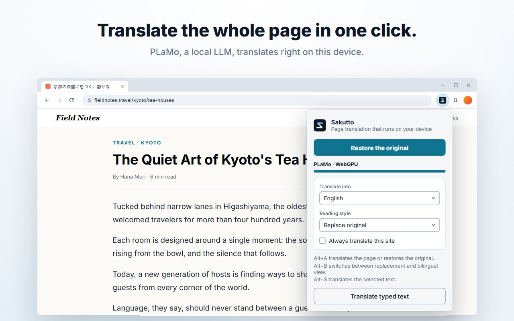
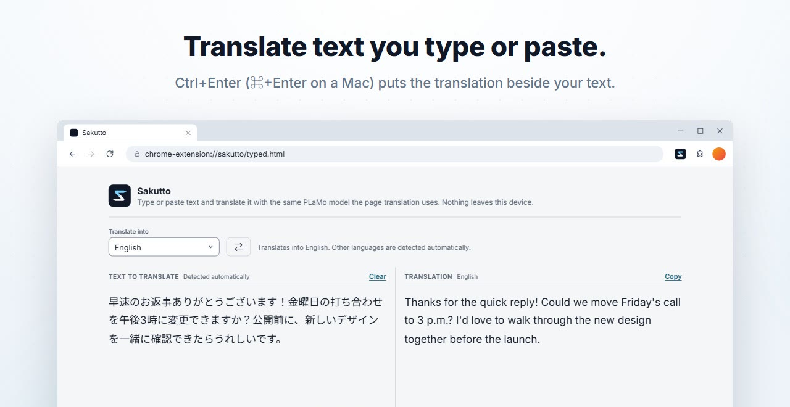
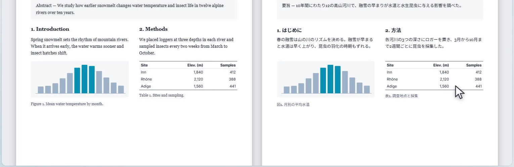
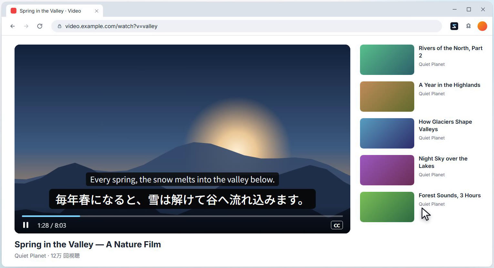
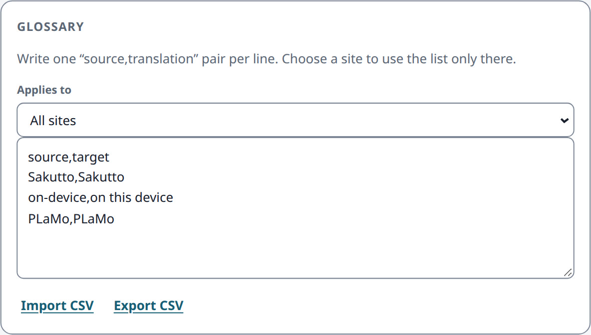
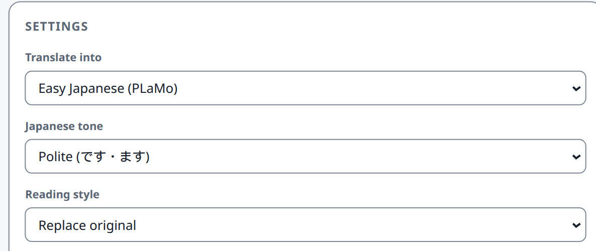
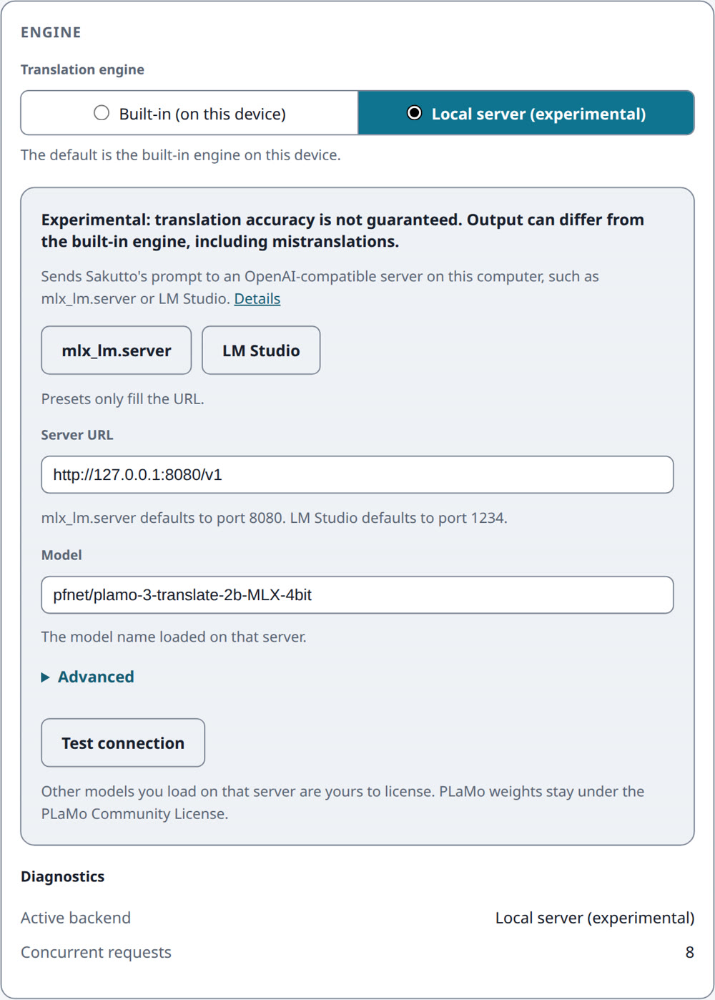

<div align="center">
  
  <h1>Sakutto</h1>
  <p><strong>Translate pages, PDFs, videos, and the text you type — locally, with PLaMo.</strong></p>
  <p>
    <a href="https://chrome.google.com/webstore/detail/mhlbjjijfkoghmcjndgdimhdlfkhadfl"></a>
    <a href="https://chrome.google.com/webstore/detail/mhlbjjijfkoghmcjndgdimhdlfkhadfl"></a>
    <a href="https://chrome.google.com/webstore/detail/mhlbjjijfkoghmcjndgdimhdlfkhadfl"></a>
    <a href="https://addons.mozilla.org/firefox/addon/sakutto-local-ai-translation/"></a>
    <a href="LICENSE"></a>
    <a href="CHANGELOG.md"></a>
    <a href="https://discord.gg/pdSRBaSr38"></a>
    <a href="https://github.com/jammaru/sakutto/stargazers"></a>
  </p>
  
</div>

Sakutto is an unofficial Chrome and Firefox extension that translates web pages, PDFs, video captions, selections, and the text you type — on your device. The default engine is [PLaMo 3 Translate](https://huggingface.co/pfnet/plamo-3-translate-0.8b-GGUF), running through a pinned [wllama](https://github.com/ngxson/wllama) build on WebGPU or CPU.

For PLaMo's 53 languages, every translated line comes from PLaMo. On Chrome, Chrome's built-in translator is used only for the 11 extra targets PLaMo cannot produce. Firefox uses PLaMo only. There is no account, no advertising, and no telemetry. Built with PLaMo. Not affiliated with Preferred Networks, Inc.

## Contents

- [Why Sakutto](#why-sakutto)
- [Features](#features)
- [Install](#install)
- [Shortcuts](#shortcuts)
- [FAQ](#faq)
- [Privacy](#privacy)
- [Permissions](#permissions)
- [Development](#development)
- [Contributing](#contributing)
- [Support](#support)
- [Contributors](#contributors)
- [Sponsors](#sponsors)
- [Licenses](#licenses)

## Why Sakutto

- **Local-first by default.** Page text, selections, your glossary, and translations stay on your device. There is no analytics or crash reporting.
- **Everything you read and write.** Translate a whole page, a selection, a PDF, video captions, a message box, or the dedicated text page — without switching tools.
- **Layout-aware PDFs.** Columns, tables, captions, and rotated pages keep their structure. Translated text is fitted into the space the source occupied.
- **Free and open source.** MIT-licensed code, no ads, no paid features, and Chrome and Firefox builds.

## Features

<table>
  <tr>
    <td width="54%" valign="top">
      <h3>Whole-page translation and selections</h3>
      <p>Translate a page in place or switch to a bilingual view. Select text for an on-device popup translation, with adjustable text size and a selection panel you can resize by dragging either edge.</p>
      <p>Set a target language per site, turn automatic translation on where you want it, and keep the page in its original language until PLaMo is ready — no draft from another engine.</p>
    </td>
    <td width="46%" valign="top">
      
    </td>
  </tr>
  <tr>
    <td width="54%" valign="top">
      <h3>Type anywhere — or on a dedicated page</h3>
      <p>Focus a message box, textarea, or other editable field and press Alt+T (Option+T on a Mac). A live preview appears above the field; press again or Ctrl+Enter (⌘+Enter) to replace the draft. Restore original puts it back.</p>
      <p>The あA button next to the field does the same, and a dedicated typed-text page handles up to 100,000 characters with a Copy button. Password fields and sites marked never translate are left alone.</p>
    </td>
    <td width="46%" valign="top">
      
    </td>
  </tr>
  <tr>
    <td colspan="2" valign="top">
      <h3>Gmail and Outlook message banner</h3>
      <p>On <code>mail.google.com</code> and Outlook on the web (<code>outlook.live.com</code>, <code>outlook.office.com</code>, <code>outlook.office365.com</code>, and <code>outlook.cloud.microsoft</code>), a banner above each expanded message offers to translate that body only when the language differs from your target. The mail site is requested once when you enable the banner from the popup or Settings, like video captions. Nothing runs until you click; × after translation restores the original and hides the banner for that message.</p>
    </td>
  </tr>
  <tr>
    <td width="54%" valign="top">
      <h3>PDF reader translation</h3>
      <p>Browsers draw PDFs in their own viewer, which extensions cannot read. Sakutto reads the file itself, opens it in its own reader, and translates page by page — English papers into Japanese, Japanese documents into English, or any other supported direction.</p>
      <p>The layout is preserved: two-column text stays in two columns, table numbers stay under their headings, and captions stay with their figures. Blocks already in the target language are left as drawn, and image-only pages are reported rather than guessed at.</p>
    </td>
    <td width="46%" valign="top">
      
    </td>
  </tr>
  <tr>
    <td width="54%" valign="top">
      <h3>Video caption translation</h3>
      <p>Translate captions on YouTube (including live) and X while the video plays, with a translated overlay on the player. HTML5 caption tracks and custom caption sites are supported too.</p>
      <p>Caption translation is off until you enable it. A size slider, draggable positions for YouTube and X, a reset button, and a hide-original control keep the overlay out of your way.</p>
    </td>
    <td width="46%" valign="top">
      
    </td>
  </tr>
  <tr>
    <td width="54%" valign="top">
      <h3>Your glossary</h3>
      <p>Keep a global glossary and per-site glossaries so names, product terms, and technical vocabulary come back the way you write them. Each stored list holds up to 5,000 terms, and a translate run can merge up to 10,000.</p>
      <p>Only terms that appear in the current text go into the prompt. Import and export CSV from Settings.</p>
    </td>
    <td width="46%" valign="top">
      
    </td>
  </tr>
  <tr>
    <td width="54%" valign="top">
      <h3>Easy Japanese (やさしい日本語)</h3>
      <p>Choose Easy Japanese as a target to turn ordinary Japanese into simpler Japanese — useful for accessibility, public information, and language learners. A Japanese page can be translated into simpler Japanese without leaving the language.</p>
      <p>This target is produced by PLaMo only. Chrome's built-in translator cannot make it, so it is never handed off to Chrome.</p>
    </td>
    <td width="46%" valign="top">
      
    </td>
  </tr>
  <tr>
    <td width="54%" valign="top">
      <h3>Local OpenAI-compatible server (experimental)</h3>
      <p>Settings can point PLaMo requests at an OpenAI-compatible server on this computer, such as <code>mlx_lm.server</code>, LM Studio, or a <code>llama-server</code>-class tool. Only PLaMo models are supported.</p>
      <p>Sakutto sends its PFML3 prompt to raw <code>/v1/completions</code>; chat completions are not used. Accuracy is not guaranteed and output can differ from the built-in engine, including mistranslations. The built-in engine stays the default.</p>
    </td>
    <td width="46%" valign="top">
      
    </td>
  </tr>
</table>

## Install

Sakutto is published on both stores:

- **Chrome Web Store** — [Sakutto - Local AI translation](https://chrome.google.com/webstore/detail/mhlbjjijfkoghmcjndgdimhdlfkhadfl) (Chrome 116 or later).
- **Firefox Add-ons** — [Sakutto - Local AI translation](https://addons.mozilla.org/firefox/addon/sakutto-local-ai-translation/) (Firefox 153 or later).

**Up and running in three steps:**

1. Install from your browser's store, then pin Sakutto to the toolbar.
2. Open the popup and choose **Translate this page** — or press Alt+A (Option+A on a Mac).
3. Accept the PLaMo licence and let the one-time model download finish. After that, translation runs on your device and works offline.

No account is needed. The model weights are not in this repository or in the store package.

## Shortcuts

| Action                                          | Windows / Linux              | Mac                                 |
| ----------------------------------------------- | ---------------------------- | ----------------------------------- |
| Translate the page, or restore the original     | Alt+A (Firefox: Alt+Shift+A) | Option (⌥)+A (Firefox: Alt+Shift+A) |
| Switch between replaced text and bilingual text | Alt+B (Firefox: Alt+Shift+B) | Option (⌥)+B (Firefox: Alt+Shift+B) |
| Translate the selection                         | Alt+S (Firefox: Alt+Shift+S) | Option (⌥)+S (Firefox: Alt+Shift+S) |
| Translate the text you are writing              | Alt+T (Firefox: Alt+Shift+T) | Option (⌥)+T (Firefox: Alt+Shift+T) |
| Open the PDF the tab shows in the reader        | Not set — bind one           | Not set                             |
| Translate typed text (on the typed-text page)   | Ctrl+Enter                   | ⌘+Enter                             |

The same actions are in the toolbar popup and the right-click menu. Chrome owns extension shortcuts, so change them in Chrome's editor: the settings page has a **Keyboard shortcuts** panel, and the popup has a **Change shortcuts** link. Firefox uses Alt+Shift+letter by default and opens Firefox's own editor.

If Chrome has assigned a command, it is delivered even while a text field is focused. If Chrome never assigned it, the in-page default still works, but Sakutto leaves the keydown unprevented so Option+letter can type. That fallback does not run on `chrome://` pages or in the PDF viewer. Alt+D is not a default because Chrome uses it for the address bar.

## FAQ

**Do I need a GPU?**

No. WebGPU is recommended for speed, and Sakutto uses it when the browser and GPU support it. If the GPU does not respond or produces garbled output, Sakutto falls back to CPU and says so. CPU translation works everywhere but is slower; Firefox extension pages are not cross-origin isolated, so Firefox CPU is single-threaded.

**How big is the model download?**

The default 0.8B Q4_K_M model is about **546 MB**. It is downloaded once from Hugging Face, verified with a pinned SHA-256 digest, and kept in the extension's on-device storage. The download can resume after an interruption, and you can delete the model and translation cache from Settings.

**Does my text leave my device?**

No, not by default. Translation runs on your device, and the developer receives no page text, selections, glossary, or translations. The extension's own network requests are the model download, a PDF fetch from the site the tab already shows, and — only if you turn it on — requests to the local server address you set. A URL outside this computer requires an explicit warning confirmation. See [PRIVACY.md](PRIVACY.md).

**Which languages are supported?**

PLaMo 3 Translate supports **53 languages in either direction**, and the source language is detected from the page. The default target follows your browser UI language, falling back to English. **Easy Japanese (`ja-easy`)** is an additional PLaMo-only target.

On Chrome, 11 further targets (cs, da, el, fi, kn, no, pt, ro, sv, tr, uk) are translated only by Chrome's built-in translator. Firefox hides those targets. The interface itself is available in 14 languages: English, Japanese, Korean, Chinese (Simplified and Traditional), Spanish, Portuguese (Brazil), French, German, Italian, Russian, Vietnamese, Thai, and Indonesian.

**Why does a page stay in the original language for a while?**

PLaMo is the only engine used for its languages, so a page waiting for the model keeps its source text instead of showing a draft from Chrome's translator. Chrome's built-in translator is used only for the 11 extra targets above, not as a faster stand-in while PLaMo loads.

**Can I use a local OpenAI-compatible server?**

Yes, as an experimental option. It works with PLaMo models on servers such as `mlx_lm.server`, LM Studio, or a `llama-server`-class process. Sakutto uses the PFML3 prompt with raw `/v1/completions`. Accuracy is not guaranteed, and translations can differ from the built-in engine. Design notes and model pins: [docs/design/mlx-backend.md](docs/design/mlx-backend.md). Mac timings: [bench/README.md](bench/README.md).

**What happens with PDFs?**

Open a PDF and choose **Translate this PDF** from the popup or right-click menu. Sakutto fetches the file the tab is showing, opens it in its own reader, and translates it there. The temporary copy stays inside the extension and is deleted when the reader tab closes; a leftover from a crash is removed within a day. Scans and image-only pages are shown with a note that there is no text to translate.

**Does it work in Firefox?**

Yes, on Firefox 153 or later. The Firefox build uses PLaMo only, with page, selection, and typed-text translation, plus the glossary and Easy Japanese. Firefox uses Alt+Shift+letter shortcuts by default. See [docs/FIREFOX.md](docs/FIREFOX.md) for the manual checklist and known platform limits.

## Privacy

Translation runs on your device by default. Sakutto does not send page text, selections, your glossary, or translations to the developer. There is no account, no advertising, no analytics, and no telemetry.

The built-in engine's own network traffic is limited to:

- the PLaMo model download from Hugging Face;
- the PDF file, fetched from the site the tab is already showing, with that tab's cookies;
- requests to an experimental local server, only when you enable it and only to the address you set.

The model file is not bundled. You can remove it and clear the translation cache in Settings. Read the full policy at [PRIVACY.md](PRIVACY.md) or <https://jammaru.com/sakutto/privacy/>.

## Permissions

| Permission         | Why it is requested                                                                  |
| ------------------ | ------------------------------------------------------------------------------------ |
| `storage`          | Saves the target language, reading style, glossary, and other settings.              |
| `unlimitedStorage` | Keeps the downloaded model and the translation cache on the device.                  |
| `offscreen`        | Runs the translation runtime in a document whose workers outlive the service worker. |
| `activeTab`        | Reads the current page after you open the popup or use a command.                    |
| `scripting`        | Injects the content script into the active tab after you ask for a translation.      |
| `contextMenus`     | Adds Translate page, Translate selection, and Translate PDF to the right-click menu. |

The release package asks for no install-time host permissions. Optional host permissions (`https://*/*` and `http://*/*`) are requested only when you turn on automatic translation for a site, enable video captions, add a custom caption site, or enable the Gmail/Outlook mail banner. Nothing is granted for every site at install time. The PDF reader adds no permission: it reads the file from the origin the `activeTab` grant already covers. Access to a local server is also optional.

## Development

Requirements: **Node.js 24+**, **pnpm 12**, and Docker for the bundled wllama build.

```bash
pnpm install
pnpm build:wllama   # once, with Docker; see docs/BUILDING.md
pnpm verify:wllama
pnpm build          # .output/chrome-mv3
pnpm build:firefox  # .output/firefox-mv3
```

<details>
<summary><strong>Build and package details</strong></summary>

`pnpm build:wllama` compiles the pinned wllama commit `d275dac` inside the `emscripten/emsdk:4.0.20` container. The wasm, workers, and model weights are not committed. `pnpm build` and `pnpm zip` refuse to run until that build has been verified. `pnpm zip` also checks that the package contains the runtime and licence texts, and that it does not contain model weights, source maps, or install-time host permissions.

```bash
pnpm dev            # development build
pnpm lint
pnpm format:check
pnpm typecheck
pnpm test
pnpm test:e2e       # local fixtures; does not download the model
pnpm zip            # Chrome Web Store zip in .output
pnpm zip:firefox    # Firefox zip; then pnpm source:firefox for the AMO source zip
```

`pnpm build` copies the pinned `pdfjs-dist` build into the package first (`pnpm pdfjs` runs that step alone). The reader loads it from a packaged file because pdf.js resolves its worker, CMaps, and standard font substitutes relative to itself.

`pnpm test:e2e` builds a test package that translates inside the page. That package is not the release build, and the release build does not include the test translator.

`pnpm icons` regenerates the PNG icons from `scripts/generate-icons.mjs`. `pnpm i18n:check` compares every catalog in `public/_locales` against English for missing keys, placeholder tokens, and empty messages. `pnpm i18n:draft <catalog> <language>` drafts a catalog with the same PLaMo model the extension ships. Both are described in [docs/TRANSLATING.md](docs/TRANSLATING.md).

</details>

<details>
<summary><strong>Page benchmarks</strong></summary>

`pnpm bench` loads the built extension in headless Chromium (Playwright's Chrome for Testing build, because branded Chrome refuses `--load-extension`) and translates four fixed local pages with the real 0.8B model: a long article, a news article, a docs page, and a client-rendered page. It also runs a short engine probe for time to first token and output speed. Pass `--pages-only`, `--engine-only`, or `--sweep` (thread, context, and batch sizes). The model is cached under `bench/.cache/` after a SHA-256 check. Build with `SAKUTTO_E2E_REAL=1 pnpm build` first so the harness can script the local pages. Results are written to `bench/results/`.

`pnpm bench:mock` and `pnpm bench:live` measure whole pages the way a reader experiences them, on eight fixtures in [bench/pages](bench/pages) that each isolate a different cost (a long article, a short lead with a long tail, many short cards, one very long paragraph, a sidebar, mixed UI, a headline inside the article header, and late-mounted content). Every run appends to `bench/history/pages.jsonl`, so a later commit can be diffed against an earlier one on the same pages. `pnpm bench:serve` opens those fixtures in your own browser. See [bench/README.md](bench/README.md) for the metrics, the mock-versus-live distinction, and how to add a fixture.

</details>

<details>
<summary><strong>PDF layout bench</strong></summary>

`bench/pdf/paper.html` is an original two-column academic paper written for this repository, and `scripts/bench/build-pdf-fixtures.ts` prints it to `bench/pdf/paper.pdf` with a real text layer (font subsets, per-glyph positions, a table, and a figure), plus `bench/pdf/scan.pdf`, the same layout as one bitmap per page with no text layer. Both are committed: they are our own text, so they are small and stay under the MIT licence.

Layout quality is checked at two speeds:

- **Fast, in CI.** `pnpm test` runs synthetic pages (two-column prose, display equations, figure labels versus axis ticks, tables, listings, running footers, image-only pages) through the same cut, fit, and overlap rules the reader uses, with a deterministic stub translator that expands like Japanese. No model is loaded. `pnpm bench:pdf:layout` runs that path on the committed PDF fixtures; it should finish in a few seconds.
- **Slow, on a machine with the model.** `pnpm bench:pdf` loads the built extension, opens a fixture through the real `pdf:open` path, and translates with PLaMo. Use `--pages N` to bound a long file, `--shot-page N` to screenshot one page, and `--keep-cache` to reuse translations already in the profile.

```bash
pnpm test                 # includes the layout-only PDF checks
pnpm bench:pdf:layout     # committed fixtures, stub translator, no model
pnpm bench:build:live     # the build the live bench loads
pnpm bench:pdf            # 8 threads, real model
pnpm bench:pdf --threads 4
pnpm bench:pdf --page scan   # the bitmap fixture, which must report no text
pnpm bench:pdf --keep-cache  # reuse translations already in the profile
```

**One model, downloaded once.** The profile at `bench/.cache/pdf-profile` keeps what the extension stored in it, so the 546 MB model is fetched on the first run and loaded from disk afterwards; a later run prints `loaded from the profile` and requests nothing. The extension is always staged at `bench/.cache/ext-live` because an unpacked extension's ID comes from its path, and its private file system is keyed by that ID — loading a build from a second path would put a second copy of the model in the same profile. The run reports how many copies it found (`1 copy of the model on disk`) and warns when it is more. Delete the profile directory to start from nothing.

</details>

## Contributing

Issues are welcome, and pull requests are very welcome. Open an [Issue](https://github.com/jammaru/sakutto/issues) first, then a pull request for that Issue if you can — that path is fully welcome, and an Issue by itself is also enough. Please use the issue forms and do not paste private page content. Questions are often faster in [Discord](https://discord.gg/pdSRBaSr38).

- [CONTRIBUTING.md](CONTRIBUTING.md) (日本語: [CONTRIBUTING.ja.md](CONTRIBUTING.ja.md))
- [Code of Conduct](CODE_OF_CONDUCT.md)
- [SECURITY.md](SECURITY.md)
- [docs/TRANSLATING.md](docs/TRANSLATING.md) for interface translations

## Support

There is no monetisation point in Sakutto. It is completely free, with no ads and no paid features.

I started it because I wanted a translation extension like this myself, and I published it because it turned out to be needed by more people than I expected. I have no plans to charge for it or to add ads.

Continuing development still takes time and money, so I opened GitHub Sponsors. If you like Sakutto, I would be glad of your support.

- **$5 a month (Supporter)**: a plan for cheering on Sakutto's ongoing development.
- **$10 a month (Backer)**: for anyone who wants to back it further. The amount changes nothing about the software.
- **One-time**: any amount, once, if a subscription is more than you need.

Neither tier adds limited features or priority support. The money goes towards new features, translation quality and speed, and ongoing maintenance. Whether you sponsor or not, Sakutto stays completely free and open source. <https://github.com/sponsors/jammaru>

## Contributors

Thank you to everyone who has contributed to Sakutto. Issues and pull requests are very welcome — see [CONTRIBUTING.md](CONTRIBUTING.md) to get started.

<a href="https://github.com/sabopura"></a>

## Sponsors

Thank you to everyone sponsoring Sakutto. Your support keeps development going.

[](https://github.com/sponsors/jammaru)

<a href="https://github.com/hykw"></a>

<!-- Maintainer: add sponsor avatars below, one per line, for example:
<a href="https://github.com/USER"></a>
-->

## Licenses

- **Project code:** MIT. See [LICENSE](LICENSE). Copyright 2026 jammaru.
- **PLaMo 3 Translate:** PLaMo Community License. The texts are in `licenses/PLaMo-Community-License-ja.txt` and `licenses/PLaMo-Community-License-en.txt`, and the same copies are packed into the extension. Personal and academic use needs no registration. Under Article 3, commercial use is allowed only with prior registration on PFN's form (<https://forms.gle/mTL8tBLrMYXKNZD56>) and income or sales for you or your affiliates of no more than 1 billion yen in the most recent fiscal year; otherwise commercial use needs a separate commercial licence from PFN. This repository's MIT licence covers Sakutto's own code, not the model weights.
- **pdf.js (`pdfjs-dist`):** Apache-2.0. The packaged copy is pinned in `package.json`, its files and SHA-256 hashes are recorded in `public/vendor/pdfjs/pdfjs-build.json`, and its licence is packed with the CMaps' and standard fonts' own licences.
- **llama.cpp, wllama, the Emscripten runtime, the Dawn WebGPU library, and Svelte:** see [NOTICE](NOTICE) and [THIRD_PARTY_NOTICES.md](THIRD_PARTY_NOTICES.md).
- `scripts/bench/fixtures/kyoto.html` is a CC BY-SA 4.0 Wikipedia derivative. It is not covered by the MIT licence and is not part of the extension package.

Japanese documentation: [README.ja.md](README.ja.md).
